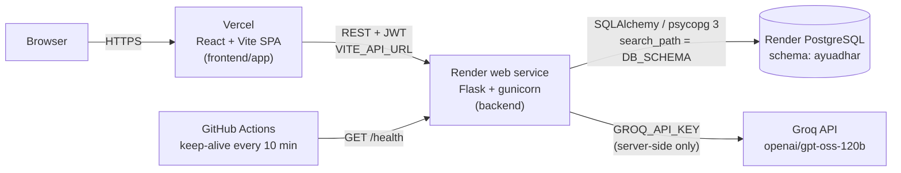

# AyuAahar

**Ayurvedic practice management for dietitians: prakriti-based diet plans, consultations, progress tracking and an AI wellness assistant.**

[](https://github.com/HarshBathija-04/AyuAdhar/actions/workflows/ci.yml)

| | |
| --- | --- |
| Live demo (Vercel) | `https://<your-vercel-app>.vercel.app` |
| API (Render) | `https://<your-render-service>.onrender.com/health` |
| Demo logins | `dietitian@ayuaahar.com` / `password123` and `patient@ayuaahar.com` / `password123` (one-click buttons on the sign-in page) |

> The API runs on Render's free tier and sleeps when idle. The first request can take up to a minute; the app shows a "waking up the server" notice while it starts.

> **Medical disclaimer:** AyuAahar provides general Ayurvedic and nutrition education. It is not medical advice and does not replace a qualified clinician.

## Features

- **Patient records** with prakriti (Vata, Pitta, Kapha, dual types, Tridosha), conditions, lifestyle, weight and height.
- **Diet plan generation**: calorie target from Mifflin-St Jeor BMR, an activity factor and BMI adjustment; foods scored against the patient's doshas (rasa, virya, dosha effects) and spread across breakfast, lunch, dinner and snacks. Recommendations are enriched from the bundled AyurGenix dataset (`Dataset/`).
- **Ask Ayu**, an AI wellness assistant (Groq, `openai/gpt-oss-120b`) that explains plans and Ayurvedic concepts using the patient's own profile and active plan. It runs only on the backend, is rate limited and always carries a medical disclaimer.
- **Appointments**: month calendar and list; dietitians schedule, patients request consultations.
- **Progress tracking**: weekly adherence and weight check-ins, logged by the dietitian or self-reported by the patient, with trends and reports.
- **Food database** with nutrition per 100 g and Ayurvedic properties (rasa, guna, virya, vipaka).
- **Two roles**: a clinical dashboard for dietitians and a personal wellness dashboard for patients, with server-side ownership checks.

## Screenshots

| Landing | Dietitian dashboard |
| --- | --- |
|  |  |
| **Diet plan** | **Ask Ayu assistant** |
|  |  |
| **Patient wellness dashboard** | **Mobile (375 px)** |
|  |  |

## Architecture



## Tech stack

| Layer | Tools |
| --- | --- |
| Frontend | React 19, TypeScript, Vite 7, Tailwind CSS 3, shadcn/ui (Radix), Chart.js, Sonner, Vitest |
| Backend | Python 3.13, Flask 3, SQLAlchemy 2, Alembic, pydantic 2, PyJWT, bcrypt, Flask-Limiter, Flask-CORS, gunicorn |
| AI | Groq Python SDK (`groq`), model `openai/gpt-oss-120b` |
| Data | PostgreSQL (one schema per app on a shared database) |
| Quality | pytest, ruff (lint + format), ESLint, Prettier, GitHub Actions CI |
| Hosting | Vercel (frontend), Render web service + Render PostgreSQL (backend) |

## Local setup

Prerequisites: Python 3.13, Node 22+, and a PostgreSQL database (or Docker).

### Option A: Docker Compose

```bash
docker compose up --build                 # Postgres + API on http://localhost:5000
docker compose --profile web up --build   # also the Vite dev server on http://localhost:5173
```

Set `GROQ_API_KEY` in your shell first if you want the assistant to work.

### Option B: run each part

```bash
# API
cd backend
python -m venv .venv && source .venv/bin/activate   # Windows: .venv\Scripts\activate
pip install -r requirements-dev.txt
cp .env.example .env                                # then edit DATABASE_URL, JWT_SECRET, GROQ_API_KEY
alembic upgrade head                                # creates the schema and tables
python seed.py                                      # idempotent demo data
python app.py                                       # http://localhost:5000 (PORT in .env)

# Web app (second terminal)
cd frontend/app
cp .env.example .env                                # VITE_API_URL=http://localhost:5000/api
npm ci
npm run dev                                         # http://localhost:5173
```

### Checks

```bash
cd backend && ruff check . && ruff format --check . && pytest -q
cd frontend/app && npm run lint && npm test && npm run build
```

Backend tests use an isolated `ayuadhar_test` schema in the database given by `TEST_DATABASE_URL` and drop it afterwards.

## Environment variables

### Backend (`backend/.env`)

| Variable | Required | Description |
| --- | --- | --- |
| `DATABASE_URL` | yes | Postgres connection string (`postgres://` is accepted and normalised). |
| `DB_SCHEMA` | no | Postgres schema for all tables. Default `ayuadhar`. Created automatically by the migrations. |
| `JWT_SECRET` | yes in production | Secret for signing JWTs. The app refuses to start in production without it. |
| `FRONTEND_URL` | yes | Allowed CORS origin(s), comma-separated, e.g. `https://ayuaahar.vercel.app`. |
| `GROQ_API_KEY` | for AI | Groq API key. Without it the assistant returns a friendly 503. |
| `APP_ENV` | no | `production` enables HSTS and the strict secret check. |
| `PORT` | no | Port for `python app.py` (Render sets it for gunicorn). |
| `DEMO_PASSWORD` | no | Password for seeded demo accounts. Default `password123`. |
| `RATELIMIT_STORAGE_URI` | no | e.g. `redis://...` to share rate limits across instances. Default in-memory. |

### Frontend (`frontend/app/.env`)

| Variable | Required | Description |
| --- | --- | --- |
| `VITE_API_URL` | yes | API base URL including `/api`, e.g. `https://ayuaahar-api.onrender.com/api`. |

## Deployment

### 1. Database (once, shared)

Create a single Render PostgreSQL instance by hand (the free plan allows one per account). Every app uses its own schema, so this project only needs its `DB_SCHEMA` (`ayuadhar`). Copy the **External/Internal Database URL**.

### 2. API on Render (Blueprint)

1. In Render, choose **New > Blueprint** and select this repository. `render.yaml` declares the `ayuaahar-api` web service (`rootDir: backend`, free plan, health check `/health`). It does not create a database.
2. When prompted, set `DATABASE_URL` to the shared database URL, `FRONTEND_URL` to your Vercel URL and `GROQ_API_KEY` to your Groq key. `JWT_SECRET` is generated automatically.
3. Each deploy runs `alembic upgrade head && python seed.py` before starting gunicorn, so the schema and demo data are always present.

### 3. Web app on Vercel

1. **Add New > Project**, import the repository and set **Root Directory** to `frontend/app` (framework preset: Vite).
2. Add `VITE_API_URL=https://<your-render-service>.onrender.com/api` and deploy. `vercel.json` provides SPA rewrites, security headers and long-lived asset caching.
3. Put the final Vercel URL into the Render service's `FRONTEND_URL`.

### 4. Keep-alive

Add a GitHub **repository variable** (Settings > Secrets and variables > Actions > Variables) named `BACKEND_URL` with the Render URL (no trailing `/health`). `.github/workflows/keep-alive.yml` pings `/health` every 10 minutes, which also exercises the database connection. Without the variable the job skips with a notice.

## API overview

All routes are under `/api` and return JSON. Errors have the shape `{"message", "code", "details?"}`.

| Area | Endpoints |
| --- | --- |
| Health | `GET /health` (also `/api/health`): runs `SELECT 1`, returns 200 `{"status":"ok","db":"ok"}` or 503 |
| Auth | `POST /register`, `POST /login` (rate limited), `GET/PUT /profile` |
| Patients | `GET/POST /patients`, `GET/PUT/DELETE /patients/:id`, `GET /patients/stats`, `GET /patient/my-data` |
| Appointments | `GET/POST /appointments`, `GET/PUT/DELETE /appointments/:id`, `GET /appointments/calendar`, `GET /appointments/stats` |
| Diet plans | `POST /generate-diet-plan/:patientId`, `GET /diet-plan/:patientId`, `GET/PUT/DELETE /diet-plans/:id`, `GET /diet-plans/:id/report` |
| Foods | `GET/POST /food-items`, `GET /food-items/:id`, `POST /analyze-nutrition` |
| Progress | `GET/POST /progress`, `GET/PUT/DELETE /progress/:id`, `GET /progress/:patientId/stats`, `GET /progress/:patientId/report` |
| AI | `POST /ai/chat` (`{messages, patient_id?}`, rate limited), `GET /ai/disclaimer` |

## Project structure

```
.
├── backend/                  Flask API (Render rootDir)
│   ├── app.py                app factory, CORS, security headers, error handling, /health
│   ├── config.py             env-driven settings (DATABASE_URL, DB_SCHEMA)
│   ├── schemas.py            pydantic request validation
│   ├── models/               SQLAlchemy models
│   ├── routes/               auth, patients, appointments, diet plans, progress, ai
│   ├── services/             diet plan engine, reports, Groq assistant
│   ├── migrations/           Alembic migrations (schema-aware)
│   ├── seed.py               idempotent demo data
│   └── tests/                pytest suite
├── frontend/app/             React + Vite SPA (Vercel root directory)
│   ├── src/pages/            route pages (dashboards, patients, plans, Ask Ayu, ...)
│   ├── src/components/       layout, shared UI, shadcn/ui primitives
│   └── src/lib/              API error helpers, cold-start tracker (+ tests)
├── Dataset/                  AyurGenix dataset used for plan recommendations
├── docs/screenshots/         README screenshots
├── Dockerfile, docker-compose.yml
├── render.yaml               Render Blueprint (web service only)
└── .github/workflows/        CI and keep-alive
```

## License

MIT
